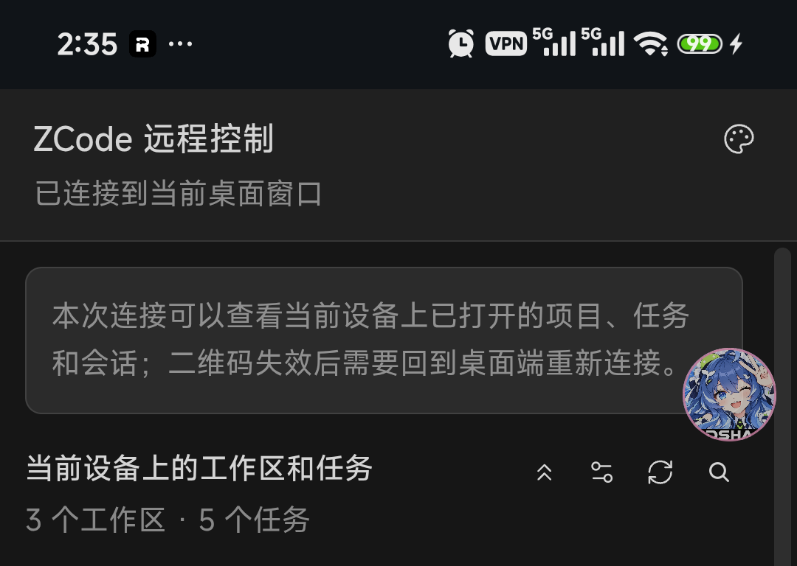
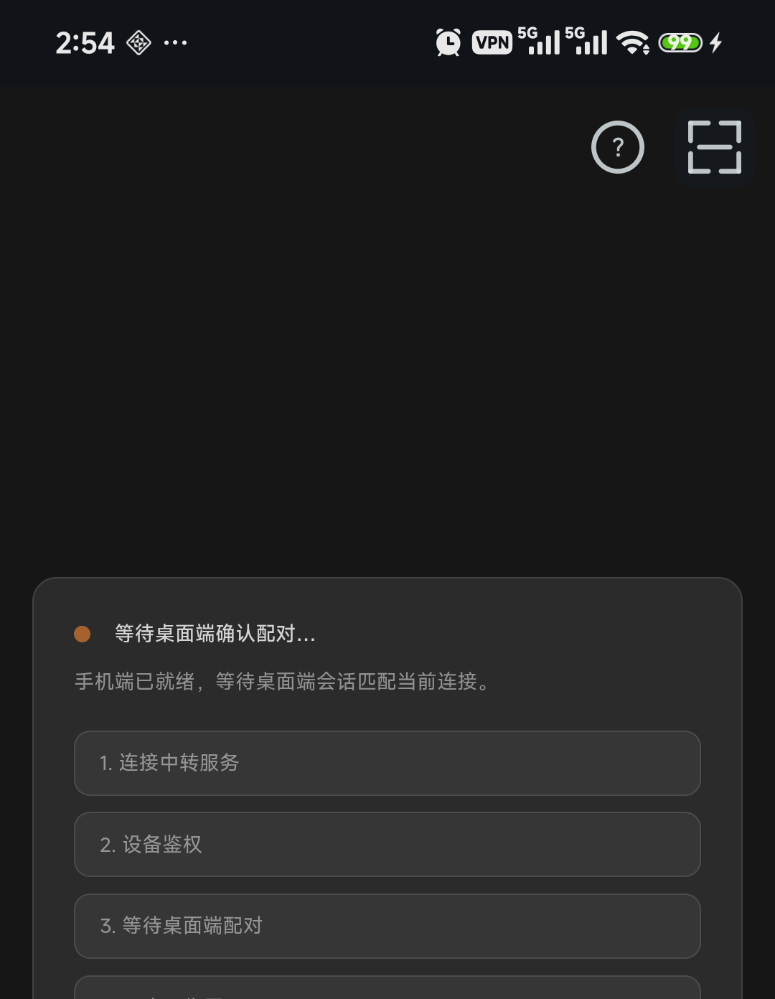

# ZRemote

> **非官方项目**：ZRemote 是一个第三方工具，与 Z.ai 及其 ZCode 产品**无任何隶属关系**。
> "ZCode" 及相关标识的版权归 Z.ai 所有，本项目未获得其赞助或授权。

一个免 Gradle 的 Android 原生客户端，为 [ZCode](https://zcode.z.ai) 的 Web 远程控制提供增强体验：
打开 APP 扫桌面端二维码即可配对，之后在手机上查看任务、接收通知、搜索会话——比浏览器标签页更快、更省心。

## 截图

| 连接正常 | 会话失效（右上角自动出现扫码 / 帮助按钮） |
| --- | --- |
|  |  |

## 功能

- **扫码配对**：APP 内直接扫桌面端配对二维码，一步完成连接（也可粘贴链接）
- **任务面板**：官方远程控制页的沉浸式壳（深/浅色跟随、外链自动外抛、文件上传/下载、断线重试）
- **会话搜索**：页面内置 🔍 一键搜索全部任务，点击直达对应会话
- **桌面直推（v2）**：电脑端 watcher 监听 ZCode 客户端本地事件，经 [ntfy](https://ntfy.sh) 秒级推到手机——
  前台流式订阅 + JobScheduler 轻量轮询兜底，取代旧版"实时模式"前台保活（更省电、更可靠）
- **任务通知**：任务完成/出错分级提醒（支持静默时段），三级来源自动去重
- **消息历史**：通知可追溯，本地存储，随用随清
- **应用锁**：PIN + 指纹（系统 BiometricPrompt），保护会话入口
- **用量入口**：内嵌智谱官方用量页，登录一次常驻可见
- **崩溃日志**：本地落盘、应用内查看

## 桌面直推（v2）部署

手机端"设置 → 桌面直推"填好服务器与 Topic 后，还需在**常开的电脑**上跑 watcher
（零依赖 Node 脚本，监听 ZCode 客户端本地日志的任务生命周期事件）：

```bash
# 独立运行：自动生成随机长 Topic（即凭据，勿外传），把打印出的 topic 填进手机
node tools/zrc-watcher.mjs --generate-topic

# 或指定参数：node tools/zrc-watcher.mjs --server https://ntfy.sh --topic <你的topic>
# 链路自检（推一条测试事件，手机上应出现"任务完成：直推链路测试"通知）：
node tools/zrc-watcher.mjs --test
```

要求：Node ≥ 18（会话标题查询需 ≥ 22.5 的 `node:sqlite`，低版本自动降级）、
ZCode 桌面客户端在本机运行（watcher 监听其用户目录 `~/.zcode/cli/` 下的日志与数据库）。
细节（事件源取证、去重与重试、隐私边界）见 [docs/v2-设计.md](docs/v2-设计.md)。
自建 ntfy 服务器只需两端同时改服务器地址，零代码改动。

## 构建

只需要 JDK（17+）与 Android 构建工具（build-tools 34+ 含 aapt2/d8/apksigner，platform android-35）。
唯一第三方库为 [ZXing core](https://github.com/zxing/zxing)（Apache-2.0，仅用于扫码配对的二维码解码，约 600KB），构建脚本首次运行时自动下载。

```bash
# 1. 准备工具链（目录结构：toolchain/android-14/ 为 build-tools，toolchain/android-35/ 为 platform）
#    默认路径为项目同级 ../toolchain，可用环境变量 ZREMOTE_TOOLCHAIN 覆盖

# 2. 构建
./build.sh              # 产物 build/zremote-release.apk

# 本地自用模式（可选）：应用名 ZCode RC + branding-local/ 下的自定义图标
LOCAL=1 ./build.sh      # 产物 build/zremote-local.apk
```

首次构建会自动生成本地签名密钥（`keystore*.jks`，不入库，请自行保管——**发布后更换签名将导致用户无法升级**）。

## 隐私

不收集任何数据：无统计 SDK、无自建服务器，全部数据（会话 Cookie、通知历史、崩溃日志）仅存 APP 私有目录。
网络通信仅限 z.ai 系与 bigmodel.cn 系官方域名（含 OAuth 登录授权域 chat.z.ai 等子域；为支持官方登录链路
启用了跨子域第三方 Cookie；页面内触发的文件下载经系统下载管理器发往上述官方域名），以及
**你主动开启"桌面直推"时你配置的 ntfy 服务器**
（默认公共 ntfy.sh；此时任务标题、状态变化与错误消息摘要经其转发，不含代码/文件/凭据，介意者可自建或关闭该功能）。
相机仅在扫码配对时本地解码，画面不存储不上传。
完整说明见应用内"设置 → 关于 → 隐私政策"或 [docs/隐私政策.md](docs/隐私政策.md)。

## 品牌

- 本项目名称、图标均为原创，与 Z.ai 官方产品存在差异
- 请勿在本仓库或分发版中包含 Z.ai 官方图标、商标等品牌资产
- 分发/二改请保留 README 中的非官方声明

## License

[Apache-2.0](LICENSE)
